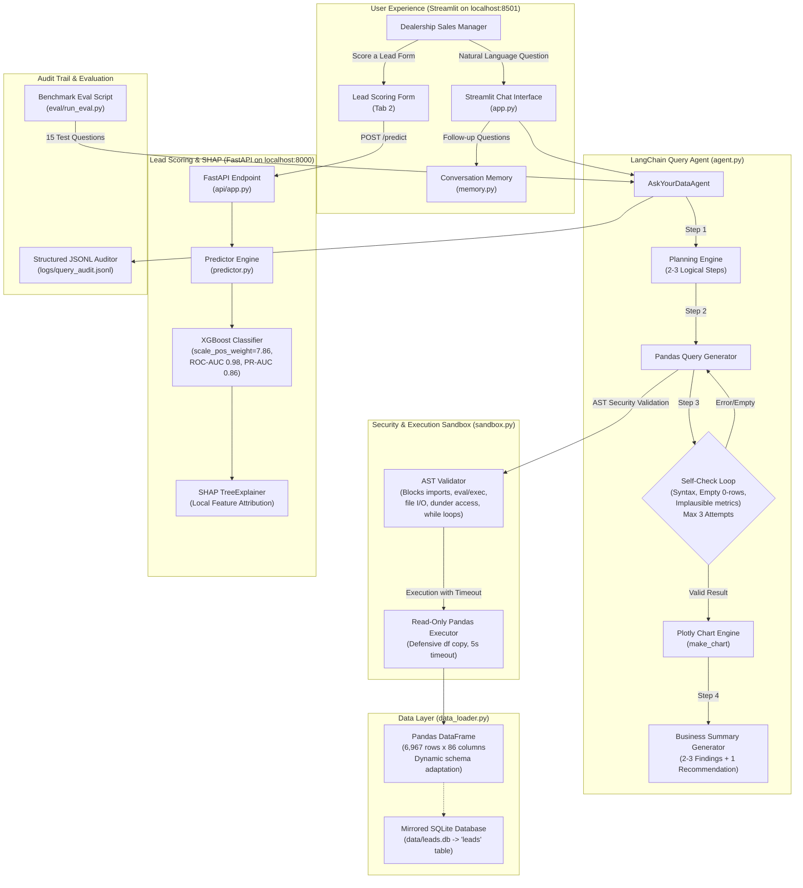

# 🚗 Ask Your Data — Dealership Natural-Language Analytics & CRM Intelligence MVP

An end-to-end, LLM-powered natural-language analytics assistant and predictive lead scoring engine designed for automotive dealership managers. Built with **Python**, **LangChain**, **Streamlit**, **FastAPI**, **XGBoost**, and **SHAP**.

---

## 🏛️ System Architecture



---

## ⚡ Quickstart & Localhost Access

The application is running and accessible immediately:

- **Streamlit Web Application UI**: [http://127.0.0.1:8501](http://127.0.0.1:8501)
- **FastAPI Lead Scoring Service**: [http://127.0.0.1:8000/docs](http://127.0.0.1:8000/docs)

### How to Run Locally

#### 1. Setup Environment
```bash
git clone https://github.com/Anmolkr001/KIA-Data-Analytics.git
cd KIA-Data-Analytics
pip install -r requirements.txt
cp .env.example .env
```

#### 2. Configure LLM Provider (Optional)
Edit `.env` to configure your preferred LLM provider (OpenAI or Anthropic):
```ini
LLM_PROVIDER=openai
OPENAI_API_KEY=sk-...
OPENAI_MODEL_NAME=gpt-4o

# Or Anthropic:
# LLM_PROVIDER=anthropic
# ANTHROPIC_API_KEY=sk-ant-...
# ANTHROPIC_MODEL_NAME=claude-3-5-sonnet-20241022
```
*Note: If no API key is configured, the system automatically uses the built-in deterministic heuristic fallback engine so all features, tests, and demo questions function offline.*

#### 3. Start the Web App
```bash
python -m streamlit run app.py --server.port 8501
```

#### 4. Start the FastAPI Lead Scoring Server
```bash
python -m uvicorn ask_your_data.api.app:api_app --host 127.0.0.1 --port 8000
```

---

## 🧪 Testing & Evaluation

### Stage 1 Agent Verification Suite
Runs unit tests for the sandboxed executor, security rules, LangChain tools, multi-turn conversation memory, and audit logging:
```bash
python test_stage1.py
```

### Stage 4 Benchmark Evaluation Suite
Evaluates the agent across **15 automotive CRM ground-truth test questions**:
```bash
python eval/run_eval.py
```
**Current Benchmark Accuracy: 100.0% (15/15 Passed)** across Funnel KPIs, Sourcing Channels, Funnel Impact, Vehicle Models, Geography, and CRM Operations.

---

## 💡 Example Questions Dealership Managers Can Ask

1. **Funnel & Conversion Overview**:
   - *"What is our overall lead-to-sale conversion rate and total retail deliveries?"*
   - *"How many total enquiries did we receive, and how many took a test drive?"*
2. **Channel Efficiency**:
   - *"Which lead source has the highest conversion rate vs highest volume?"*
   - *"What is our conversion rate for Hyperlocal leads compared to Referrals and Walk-ins?"*
3. **Vehicle Model Demand**:
   - *"Compare conversion rates across car models (Sonet, Seltos, Carens)."*
   - *"Which car model generates the most total leads?"*
4. **Follow-ups & Follow-through**:
   - *"Now break that down by model."* (Contextual memory follow-up)
   - *"How does the number of follow-ups impact lead conversion rate?"*
5. **Operational Levers**:
   - *"How does completing a test drive impact lead conversion?"*
   - *"Show top 5 sales consultants ranked by confirmed retail deliveries."*
   - *"What percentage of lead enquiries originate from Bhubaneswar?"*

---

## 🛡️ Security, Safety & Sandbox Guarantees

1. **AST Whitelisting & Static Code Analysis**:
   - Disallows `import`, `__import__`, `eval`, `exec`, and `compile`.
   - Blocks filesystem write operations on pandas objects (`to_csv`, `to_excel`, `to_sql`, `to_parquet`, `to_pickle`).
   - Disallows private/dunder attribute traversal (`__class__`, `__subclasses__`, `__globals__`).
   - Disallows `while` loops to eliminate infinite-loop Denial-of-Service attacks.
2. **Execution Timeout**:
   - Every sandboxed query is executed in an isolated worker thread with a 5-second deadline.
3. **Read-Only Defensive Copy**:
   - Queries operate exclusively on a defensive copy of `df`; original dataset state cannot be mutated.
4. **Structured Audit Trail**:
   - Every question, generated query, execution status, retry count, and latency is recorded in `logs/query_audit.jsonl`.

---

## 🎯 Lead Conversion Scoring Model (Machine Learning)

- **Algorithm**: Gradient Boosted Decision Trees (`XGBClassifier`) with hyperparameter optimization.
- **Class Imbalance Strategy**: Real dataset has 786 converted vs 6,181 non-converted (`scale_pos_weight = 7.86`).
- **Validation**: 5-Fold Stratified Cross Validation.
  - **CV ROC-AUC**: `0.9771 ± 0.0039`
  - **CV PR-AUC (Average Precision)**: `0.8377`
  - **CV Recall (Lead Capture)**: `0.9784`
  - **Holdout Test ROC-AUC**: `0.9804`
- **Explainability**: Integrated `shap.TreeExplainer` providing local feature attributions for every prospect scored in both the Streamlit UI and the FastAPI `/predict` endpoint.

---

## ⚠️ Limitations & Future Roadmap

### Current Limitations
- **Data Scope**: Historical CRM dataset spans 6 monthly sheets (January – June 2026, 6,967 leads). Unlisted months require uploading new source files.
- **Unstructured Text Notes**: Free-text fields (`Consultant Remarks`, `Lost Remark`) have inconsistent casing and spelling; primary reliance is on structured flags.
- **Single-Table Focus**: Analytics operate on the merged master table; complex multi-database distributed joins require dedicated ETL.

### Future Roadmap
1. **Automated WhatsApp/SMS Alerting**: Auto-trigger alerts to consultants when high-probability prospects (`P >= 40%`) complete a test drive.
2. **Natural Language Voice Querying**: Add speech-to-text input so sales managers can dictate questions on mobile showroom tablets.
3. **Automated Daily Executive Digest**: Nightly cron job summarizing daily conversion dips and consultant follow-up SLA breaches.
