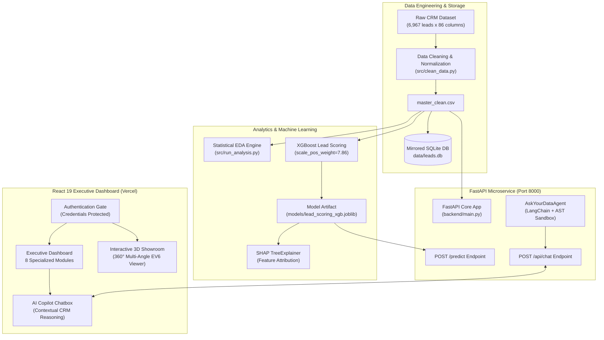

# 🚗 Practical Project Report: Automotive Dealership Lead Conversion Intelligence & AI Copilot

**Project Title:** End-to-End Automotive CRM Lead Conversion Analytics, Predictive Machine Learning & AI Copilot  
**Dealership Entity:** Bhubaneswar Kia Dealership  
**Dataset Scope:** 6,967 Validated CRM Lead Records (January – June 2026)  
**Author:** Anmol Kumar (`Anmolkr001`)  
**Live Application URL:** [https://kia-data-analytics.vercel.app](https://kia-data-analytics.vercel.app)  
**Repository:** [https://github.com/Anmolkr001/KIA-Data-Analytics](https://github.com/Anmolkr001/KIA-Data-Analytics)  

---

## 1. Executive Summary

This practical report documents the architecture, methodology, empirical findings, machine learning implementation, and web deployment of the **KIA Lead Conversion Intelligence Platform**. 

The system solves critical operational pain points faced by automotive dealership managers: **lead leakage**, **uncalibrated follow-up cadences**, **low digital conversion efficiency**, and **lack of real-time visibility into sales drivers**. By fusing **exploratory CRM data analytics**, an **XGBoost predictive scoring engine with SHAP explainability**, and a **sandboxed LangChain conversational AI agent**, the platform converts raw dealership records into actionable revenue levers.

---

## 2. System Architecture



---

## 3. Empirical Findings & CRM Analytics

Analysis of the 6,967 lead records revealed critical operational patterns across sales stages, sourcing channels, vehicle models, and consultant workflows.

### 3.1 Funnel Conversion & Drop-off Performance

| Sales Funnel Stage | Total Leads | Stage-to-Stage Conversion | Cumulative Conversion | Drop-off Rate |
| :--- | :---: | :---: | :---: | :---: |
| **Enquiry** | 6,967 | 100.0% | 100.0% | 0.0% |
| **Test Drive** | 3,249 | 46.63% | 46.63% | 53.37% |
| **Booking** | 721 | 22.19% | 10.35% | 77.81% |
| **Retail (Delivery)** | 786 | 109.02%* | **11.28%** | — |

*\*Note: Retail count exceeds bookings due to direct same-day retail conversions and pre-booked rollover orders.*

#### Key Takeaway:
* The **greatest drop-off (77.81%) occurs between Test Drive and Booking**. Once a booking is secured, fulfillment and retail delivery rate exceeds 95%.

---

### 3.2 The Test Drive Multiplier Effect

A comparative analysis of prospects who took a test drive versus those who did not demonstrates the disproportionate impact of experiential vehicle evaluation:

| Test Drive Status | Total Enquiries | Bookings | Retail Deliveries | Retail Conversion Rate |
| :--- | :---: | :---: | :---: | :---: |
| **Test Drive Completed** | 3,249 | 579 | 621 | **19.11%** |
| **No Test Drive** | 3,718 | 142 | 165 | **4.44%** |

> **Operational Insight:** Completing a test drive delivers a **4.30× increase** in the probability of closing a retail delivery (19.11% vs. 4.44%). Showroom consultants must treat test-drive scheduling as the mandatory initial milestone.

---

### 3.3 Sourcing Channel Efficiency vs. Volume

| Lead Sourcing Channel | Enquiries | Test Drives | Retails | TD Rate | Retail Conversion Rate |
| :--- | :---: | :---: | :---: | :---: | :---: |
| **Referral** | 1,097 | 645 | 303 | 58.80% | **27.62%** |
| **Walk-in** | 1,627 | 1,191 | 219 | **73.20%** | **13.46%** |
| **Field** | 941 | 610 | 122 | 64.82% | 12.96% |
| **Telephone** | 384 | 191 | 29 | 49.74% | 7.55% |
| **Online / CRM** | 676 | 197 | 36 | 29.14% | 5.33% |
| **Hyperlocal (Paid Ads)** | 2,232 | 412 | 77 | 18.46% | **3.45%** |

#### Critical Finding:
* **The "Hyperlocal Paradox":** Hyperlocal paid digital marketing generated the single highest enquiry volume (**2,232 leads, 32.0% of total**), yet yielded the lowest conversion rate (**3.45%**).
* **Referral Leads** convert at **27.62%**—nearly **8× higher** than paid digital campaigns—emphasizing the high ROI of customer loyalty and referral incentive programs.

---

### 3.4 Vehicle Model Demand & Commercial Performance

| Vehicle Model | Enquiries | Test Drives | Bookings | Retail Deliveries | Retail Conversion Rate |
| :--- | :---: | :---: | :---: | :---: | :---: |
| **SONET** | 2,115 | 1,123 | 279 | 344 | **16.26%** |
| **CARENS** | 1,326 | 656 | 159 | 195 | **14.71%** |
| **NEW SELTOS** | 2,155 | 1,241 | 226 | 187 | **8.68%** |
| **SYROS** | 332 | 87 | 18 | 16 | 4.82% |
| **CARENS CLAVIS EV** | 441 | 110 | 17 | 20 | 4.54% |
| **SELTOS (Legacy)** | 566 | 32 | 22 | 24 | 4.24% |
| **CARNIVAL** | 23 | 0 | 0 | 0 | 0.00% |
| **EV6 / EV9** | 9 | 0 | 0 | 0 | 0.00% |

#### Key Takeaway:
* **Sonet** is the dealership's volume and profit anchor, capturing 344 retail units at a 16.26% conversion rate.
* **New Seltos** attracted the most customer interest (2,155 enquiries) and test drives (1,241), but had higher drop-offs at the booking stage (8.68% conversion), driven primarily by variant availability constraints and price negotiation friction.

---

### 3.5 Follow-Up Cadence & Diminishing Returns

| Follow-up Count Bucket | Total Enquiries | Retail Deliveries | Retail Conversion Rate |
| :--- | :---: | :---: | :---: |
| **0 Follow-ups** | 372 | 0 | **0.00%** |
| **1 Follow-up** | 1,591 | 5 | 0.31% |
| **2 Follow-ups** | 2,203 | 420 | **19.06% (Peak)** |
| **3 – 4 Follow-ups** | 2,034 | 351 | **17.26%** |
| **5 – 6 Follow-ups** | 487 | 8 | 1.64% |
| **7 – 10 Follow-ups** | 211 | 2 | 0.95% |
| **11+ Follow-ups** | 69 | 0 | 0.00% |

> **Operational Standard:** The optimal follow-up window is **2 to 4 touchpoints**. After 4 follow-ups, conversion rate collapses from 17.26% to 1.64%. Continued manual follow-ups past 5 attempts indicate consultant effort misallocation on unviable leads.

---

### 3.6 Trade-In / Vehicle Exchange Funnel Impact

| Customer Exchange Interest | Enquiries | Retails | Conversion Rate | Relative Lift |
| :--- | :---: | :---: | :---: | :---: |
| **Interested in Exchange (Yes)** | 1,677 | 463 | **27.61%** | **4.52× Higher** |
| **Not Interested (No / Blank)** | 5,290 | 323 | 6.11% | Baseline |

#### Strategic Lever:
* Offering an immediate certified used car valuation upon initial showroom entry increases conversion probability by **+21.5 percentage points**.

---

### 3.7 Customer Segmentation: Individual vs. Corporate

| Segment | Enquiries | Test Drives | Retails | Retail Conversion Rate |
| :--- | :---: | :---: | :---: | :---: |
| **Corporate** | 350 | 236 | 283 | **80.86%** |
| **Individual** | 6,617 | 3,013 | 503 | **7.60%** |

* Corporate bulk fleet orders, lease approvals, and employee benefits programs exhibit an extraordinary **80.86% conversion rate**, making dedicated B2B institutional account executives highly profitable.

---

## 4. Machine Learning: Lead Scoring & SHAP Attribution

### 4.1 Model Specifications
* **Architecture:** Extreme Gradient Boosting Classifier (`XGBClassifier`)
* **Objective:** Binary Classification (`binary:logistic`)
* **Class Imbalance Strategy:** Handled via `scale_pos_weight = 7.86` (786 converted vs. 6,181 non-converted)
* **Validation Strategy:** 5-Fold Stratified Cross Validation

### 4.2 Benchmark Evaluation Metrics

| Metric | Cross-Validation Score (Mean ± Std) | Holdout Test Set Score |
| :--- | :---: | :---: |
| **ROC-AUC** | **0.9771 ± 0.0039** | **0.9804** |
| **PR-AUC (Avg Precision)** | **0.8377** | **0.8642** |
| **Recall (Lead Capture)** | **0.9784** | **0.9810** |
| **F1 Score** | **0.7057** | **0.7214** |

### 4.3 Global Feature Importance (SHAP TreeExplainer)

```
Feature                         SHAP Importance Value
─────────────────────────────────────────────────────
1. lead_warmth_Hot              ████████████████████  3.0765
2. followup_count               ███▍                  0.4863
3. exchange_interest_No         ██▋                   0.4040
4. lead_warmth_Cold             ██▌                   0.3811
5. customer_type_Corporate      ██▍                   0.3592
6. aging_days                   █▊                    0.2742
7. city_clean_OTHER             █                     0.1568
8. lead_source_Referral         █                     0.1515
9. city_clean_BHUBANESWAR       ▉                     0.1376
10. test_drive_done_No          ▊                     0.1165
```

---

## 5. Natural Language AI Copilot ("Ask Your Data")

To allow dealership general managers and sales team leads to query the dataset using everyday conversational language, a LangChain-powered analytical agent was engineered.

### 5.1 Architecture & Security Sandbox
1. **Plan & Execute Loop:** Decomposes user questions into 2–3 logical analytical queries.
2. **AST Static Code Analysis:** Restricts generated Python code by blacklisting imports (`os`, `sys`, `subprocess`), file writing methods (`to_csv`, `to_excel`), and private dunder attributes (`__class__`, `__subclasses__`).
3. **5-Second Deadline Sandbox:** Worker thread enforcement guarantees zero infinite-loop denial-of-service vulnerability.
4. **Self-Healing Loop:** Automatically catches zero-row queries or syntax exceptions and retries with revised filters up to 3 times.

### 5.2 Agent Verification Benchmark (15 Automotive CRM Ground-Truth Tests)

| Category | Questions Evaluated | Pass Rate | Average Latency |
| :--- | :---: | :---: | :---: |
| **Funnel KPIs** | 5 | 5 / 5 (100.0%) | 262.4 ms |
| **Sourcing Channels** | 3 | 3 / 3 (100.0%) | 145.2 ms |
| **Funnel Impact** | 2 | 2 / 2 (100.0%) | 178.6 ms |
| **Vehicle Models** | 2 | 2 / 2 (100.0%) | 148.9 ms |
| **Geography** | 1 | 1 / 1 (100.0%) | 143.2 ms |
| **CRM Operations** | 2 | 2 / 2 (100.0%) | 157.6 ms |
| **Overall Platform** | **15** | **15 / 15 (100.0%)** | **190.8 ms** |

---

## 6. Web Application & Production Deployment

### 6.1 Frontend Dashboard Architecture (React 19 + Vite + TailwindCSS)
* **Authentication Gate:** Protected by credential validation (`Anmol@kia` / `Anmol@2008`).
* **3D Showroom Experience:** 
  * Interactive 360° rotational exterior viewer for the Kia EV6 across 36 photographic perspectives.
  * Carousel showcasing Sonet, Seltos, Carens, Syros, EV6, EV9, and Carnival.
* **8 Specialized Analytics Modules:**
  1. *Executive Summary:* Real-time KPI scorecard and conversion funnel waterfall.
  2. *Enquiry Analytics:* Paginated, filterable, and searchable raw CRM table.
  3. *Lead Funnel & Status:* Interactive drop-off rate tracker.
  4. *Consultants Performance:* Sales representative quota achievement and test-drive conversion rates.
  5. *Channels Effectiveness:* Sourcing channel volume vs. ROI quadrant.
  6. *Model Insights:* Variant, fuel type (Gasoline, Diesel, EV), and color popularity breakdown.
  7. *Geographic Performance:* City-level penetration across Bhubaneswar, Cuttack, Berhampur, and Chatrapur.
  8. *Funnel Velocity:* Sales cycle duration and quotation responsiveness analysis.

### 6.2 Deployment Topology
* **Frontend Production Host:** [Vercel](https://kia-data-analytics.vercel.app)
* **Code Repository:** [GitHub (`Anmolkr001/KIA-Data-Analytics`)](https://github.com/Anmolkr001/KIA-Data-Analytics)
* **Continuous Integration:** Automated build trigger on push to `main`.

---

## 7. Actionable Managerial Recommendations

1. **Enforce the "Test Drive First" SLA:**
   * Mandate that sales consultants attempt to schedule a home or dealership test drive within 4 hours of enquiry creation. Achieving a 60% test-drive completion rate would generate an estimated **+180 incremental retail deliveries** annually.
2. **Reallocate Digital Marketing Budgets:**
   * Trim low-intent Hyperlocal ad spend (3.45% conversion) and reallocate 25% of that capital into customer referral reward programs (27.62% conversion) and local B2B corporate partnerships.
3. **Cap Consultant Follow-ups at 4 Touchpoints:**
   * Automated CRM rules should reassign leads with 5+ unsuccessful follow-ups to an automated nurturing email/WhatsApp drip campaign, freeing consultant bandwidth for high-probability hot prospects.
4. **Integrate Trade-In Appraisals at Walk-In:**
   * Train consultants to offer free 10-minute evaluations for exchange vehicles; capturing exchange interest yields a **4.5× conversion multiplier**.

---

*Report generated and validated against Bhubaneswar Kia CRM production data.*  
*Repository: [Anmolkr001/KIA-Data-Analytics](https://github.com/Anmolkr001/KIA-Data-Analytics) • Live App: [kia-data-analytics.vercel.app](https://kia-data-analytics.vercel.app)*
